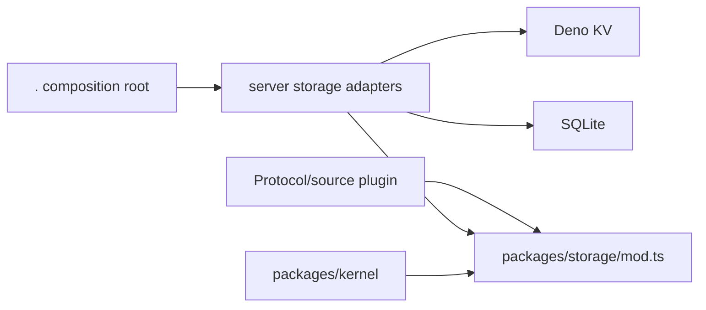

# Storage Boundary

`packages/storage/mod.ts` is the runtime-neutral persistence boundary. It has no
imports and exposes only `StoragePort`, `ConfigStore`, and `RequestStore`
contracts plus serializable DTOs and storage errors.

Protocol, source, middleware, and preset plugins may depend on `mod.ts`. They
must not import server storage adapters, `Deno.Kv`, `node:sqlite`, or a database
handle. A plugin can receive a namespaced `ConfigStore` from its host when
configuration access is explicitly granted.

Concrete adapters belong to the server composition root and translate runtime
values to these neutral DTOs. Keeping them outside this package prevents runtime
dependencies from leaking into the public contract.

## Dependency direction

The arrows point from consumers to the boundary they are allowed to use.
Runtime-specific code is confined to the host adapter edge.

## Implementation sequence

1. New plugins accept a `ConfigStore` capability instead of importing a KV
   namespace.
2. The server composition root opens Deno KV/SQLite and supplies adapters.
3. Add or replace server adapters without changing protocol or source packages.
